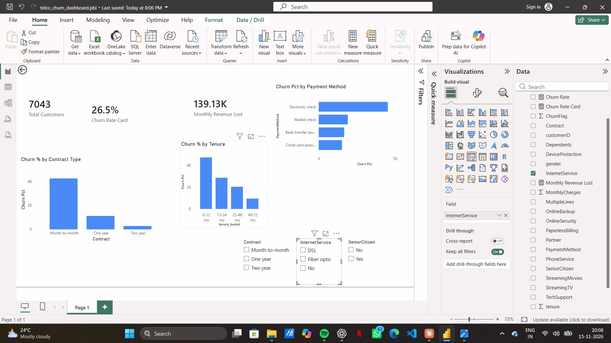
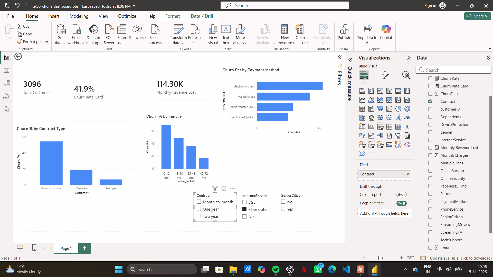

# Telco Customer Churn Analysis

An end-to-end analysis of why telecom customers leave, using Python, SQL and Power BI.

## Business question
Which customers are churning, why, and how much monthly revenue is at risk?

## Dataset
IBM Telco Customer Churn dataset (Kaggle): 7,043 customers, 21 columns.
Link: https://www.kaggle.com/datasets/blastchar/telco-customer-churn

## Tools
Python (pandas, seaborn, scikit-learn), SQLite, Power BI

## Approach
1. **Python:** Cleaned the data. `TotalCharges` had 11 blanks, all for customers with
   0 months of tenure (new sign-ups with no bills yet), so I filled them with 0
   instead of deleting them. Then ran EDA and a logistic regression.
2. **SQL:** Loaded the cleaned data into SQLite and wrote queries using GROUP BY,
   CASE, a CTE and a window function. Results match the Python numbers.
3. **Power BI:** Built an interactive dashboard with KPI cards, three charts
   and slicers.

## Key findings
- **26.5%** of customers churned (1,869 of 7,043).
- **Contract:** month-to-month customers churned at **42.7%** vs **2.8%** for two-year.
- **Tenure:** customers in their first 12 months churned at **47.4%** vs **9.5%** for 4+ years.
- **Internet service:** fiber optic churned at **41.9%** vs **19.0%** for DSL.
- **Payment:** electronic check users churned at **45.3%** vs 15-19% for other methods.
- **Biggest segment:** month-to-month fiber customers are 30% of customers but account
  for about **$100K of the $139K** monthly revenue lost.
- **Hotspot:** new month-to-month fiber customers (first 12 months) churned at **70.2%**.
- **Model:** logistic regression caught **78%** of churners (recall) at 51% precision.
  Contract type, tenure and fiber optic were the strongest drivers.

## Dashboard

## Recommendations
1. Offer discounts to move month-to-month customers onto annual contracts.
2. Add onboarding and check-in calls during the first 12 months.
3. Investigate fiber optic pricing and service quality.
4. Encourage automatic payments over electronic check.

## Limitations
This is observational data, so these are associations, not proven causes. The model
trades precision for recall, so some flagged customers would have stayed anyway.

## Files
- `notebooks/churn_analysis.ipynb`: cleaning, EDA and model
- `sql/churn_queries.sql`: SQL queries
- `dashboard/telco_churn_dashboard.pbix`: Power BI file
- `data/telco_clean.csv`: cleaned dataset
- `images/`: dashboard screenshots and charts

## Author
Kabilkumar
